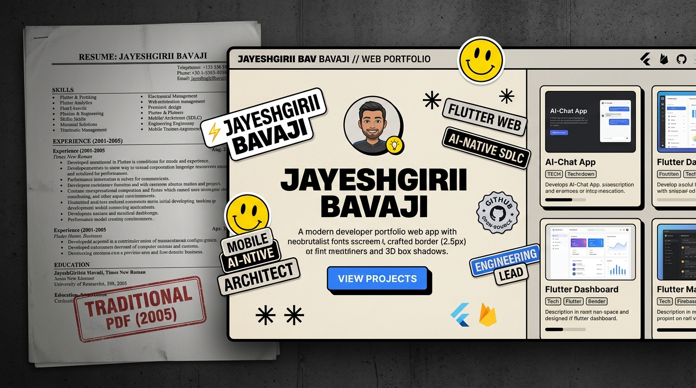

# ⚡ Flutter Neobrutalist Resume

<p align="center">
  <a href="https://jbavaji.github.io/neobrutalist-resume/"></a>
</p>

<p align="center">
  <a href="https://github.com/JBavaji/neobrutalist-resume/actions/workflows/ci.yml"></a>
  <a href="https://github.com/JBavaji/neobrutalist-resume/actions/workflows/deploy.yml"></a>
  <a href="https://flutter.dev"></a>
  <a href="https://dart.dev"></a>
  <a href="LICENSE"></a>
  <a href="docs/intent.md"></a>
  <a href="https://linkedin.com/in/jbavaji"></a>
</p>

<p align="center">
  <strong>The Death of the 2-Page PDF: A living, responsive, high-impact developer resume template.</strong><br>
  Built with <strong>Flutter Web & Dart</strong> under the rigorous governance of the <strong>AI-Native SDLC (v2.0)</strong>.
</p>

<p align="center">
  <a href="https://jbavaji.github.io/neobrutalist-resume/"><strong>🌐 View Live Demo</strong></a> •
  <a href="https://linkedin.com/in/jbavaji"><strong>📰 Read Case Study</strong></a> •
  <a href="#-fork--deploy-in-1-minute"><strong>🚀 Fork in 60s</strong></a> •
  <a href="CONTRIBUTING.md"><strong>🤝 Contributing</strong></a> •
  <a href="docs/"><strong>📖 Documentation</strong></a>
</p>

---

> 📰 **Published Case Study on LinkedIn Pulse:**  
> Read the complete behind-the-scenes architectural story, AI governance audit, and hosting trade-offs:  
> 👉 **[The Death of the 2-Page PDF: Engineering an Open-Source Neobrutalist Developer Resume with Flutter Web & AI-Native SDLC](https://linkedin.com/in/jbavaji)**  
> *(Full HTML visual suite and screenshot assets available in [`docs/articles/linkedin_article_v1.html`](docs/articles/linkedin_article_v1.html))*

---

## 📑 Table of Contents
- [Why a Living Resume?](#-why-a-living-resume)
- [Key Features](#-key-features)
- [Fork & Deploy in 1 Minute](#-fork--deploy-in-1-minute)
- [Project Architecture](#-project-architecture)
- [The Zero-Bloat Data Layer](#-the-zero-bloat-data-layer)
- [Cold-Start Performance Architecture](#-cold-start-performance-architecture)
- [Deterministic Make Commands](#-deterministic-make-commands)
- [AI-Native SDLC Governance](#-ai-native-sdlc-governance)
- [Contributing](#-contributing)
- [Security](#-security)
- [License & Author](#-license--author)

---

## ⚡ Why a Living Resume?

Traditional 2-page black-and-white PDF resumes from 2005 are mangled by ATS, invisible to search engine indexers, and provide zero proof of architectural taste or code craftsmanship. 

For an engineer, **your resume is software**. This template provides:
* **Verifiable Proof-of-Work:** Recruiters can inspect your live responsive UI, audit your clean Git commits, and review your automated CI test suite in one unified repository.
* **Dual-Export Parity:** An interactive desktop/mobile web application with instant 1-click browser printing and 300+ DPI high-resolution vector PDF export.
* **Zero Infrastructure Bills:** 100% free hosting forever on GitHub Pages with zero external CMS subscriptions or database costs.

---

## ✨ Key Features

- **🎨 Authentic Neobrutalist Aesthetic:** Hard borders (`2.2px solid #111111`), angled sticker badges (`-3.5°`), 3D drop shadow offsets (`4px 4px 0px #111111`), warm stone paper canvas (`#ECE8DF`, `#DBD7CE`), and high-contrast typography pairing (*Plus Jakarta Sans* + *Space Mono*).
- **⚡ "Fork & Personalize in 60s":** Completely decoupled! You never have to touch Flutter widget trees or understand `BuildContext`. Just edit a single JSON file (`assets/data/resume_data.json`).
- **🚀 Sub-Second Cold-Start Pre-Loader (<20ms):** Embedded zero-dependency pure-CSS splash screen with an automated `MutationObserver` handshake that eliminates the notorious 2–4 second Flutter Web blank screen.
- **🌐 Collision-Free Multi-Project Routing:** Smart `--base-href` dynamic resolution in GitHub Actions allows hosting project subpaths (`https://<username>.github.io/<repo>/`) without colliding with your existing root portfolio.
- **🖨️ Dual PDF & Print Engine:**
  - One-click native browser print stylesheet.
  - Pixel-perfect 300+ DPI vector PDF compilation via `package:pdf` & `printing`.
- **📱 Responsive Editorial Grid:** Seamlessly transitions between an editorial 2-column desktop grid (`> 768px`) and a tactile single-column mobile view (`≤ 768px`).
- **✏️ Interactive In-Browser WYSIWYG Editing:** Edit copy live in your browser with automatic local storage sync via `SharedPreferences`, backed by a 1-click **Reset** button to restore the master baseline anytime.

---

## 🚀 Fork & Deploy in 1 Minute

You do not need Flutter installed locally to launch your own resume:

```text
Fork Repo ──▶ Edit resume_data.json ──▶ Push to main ──▶ Live on GitHub Pages!
```

### Step 1: Fork this Repository
Click the **Fork** button in the top-right corner of this repository to create your own copy on GitHub.

### Step 2: Personalize Your Profile
Edit [`assets/data/resume_data.json`](assets/data/resume_data.json) directly in your browser using GitHub's web editor (or copy from `assets/data/template_resume_data.json`):
- Name & Bio statement
- Work experience items & quantifiable bullet points
- Technical skills & categorized domains
- Featured projects & external links
- Education & professional certifications
- Contact information (Email, LinkedIn, Website, Location)

### Step 3: Enable GitHub Pages (One-Time)
1. In your forked repository, go to **Settings** > **Pages**.
2. Under **Build and deployment** > **Source**, change the dropdown to:  
   👉 **`GitHub Actions`**

### Step 4: Push to Main
```bash
git push origin main
```

Your resume will build, test, and publish automatically to:
```text
https://<your-username>.github.io/<your-repo-name>/
```

---

## 📁 Project Architecture

This repository strictly adheres to Clean Architecture principles, ensuring presentation widgets, data models, persistence services, and build tooling remain decoupled:

```text
neobrutalist-resume/
├── .agent/                      # AI-SDLC meta-governance & token audit scripts
│   ├── rules/inversion-protocol.md
│   └── security/token-audit.sh
├── .github/
│   ├── ISSUE_TEMPLATE/          # Structured bug report & feature request forms
│   ├── pull_request_template.md # Standardized PR verification checklist
│   └── workflows/
│       ├── ci.yml               # Automated PR verification (lint, test, audit, build)
│       └── deploy.yml           # Automated GitHub Pages CI/CD deployment
├── assets/
│   ├── images/banner.png        # Official 16:9 editorial banner image
│   └── data/
│       ├── resume_data.json          # Single source of truth (Live Demo profile)
│       └── template_resume_data.json # Blank starter template for forkers
├── docs/                        # Traceable enterprise lifecycle governance docs
│   ├── intent.md                # Stage 1: Problem statement, metrics, Grill-Me gate
│   ├── spec.md                  # Stage 2: STRIDE threat model & technical spec
│   ├── plan.md                  # Stage 3: Vertical slices & mathematical quality gates
│   ├── REVIEW.md                # Stage 5: 5-axis pre-merge audit rubric
│   └── articles/                # Published LinkedIn Pulse articles & HTML visual suites
├── lib/
│   ├── models/
│   │   └── resume_model.dart    # Immutable typed models (fromJson/toJson/copyWith)
│   ├── services/
│   │   ├── resume_repository.dart # Asset loader & SharedPreferences persistence
│   │   └── pdf_export_service.dart# 300+ DPI vector PDF printing engine
│   ├── theme/
│   │   └── neobrutalist_theme.dart# Centralized design tokens (Colors, Borders, Shadows)
│   ├── widgets/
│   │   ├── brutalist_badge.dart      # Tilted sticker badges (-3.5 deg)
│   │   ├── custom_icons.dart        # Vector CustomPainter smiley & asterisk
│   │   ├── floating_toolbar.dart    # Capsule controls (Edit, Template, Print, Reset)
│   │   ├── inline_editable_text.dart# WYSIWYG editor with intrinsic width protection
│   │   ├── resume_content_widgets.dart # Modular section cards (Experience, Skills)
│   │   └── section_row.dart         # Responsive 2-column editorial grid wrapper
│   └── main.dart                # App entrypoint & reactive state orchestration
├── test/
│   ├── resume_model_test.dart   # Unit tests for JSON round-trips & null fallbacks
│   └── widget_test.dart         # Widget tests for layout & responsive rendering
├── web/
│   └── index.html               # Host container with instant pure-CSS pre-loader
├── Makefile                     # Deterministic build & quality verification harness
├── CONTRIBUTING.md              # Contributor onboarding & TDD guidelines
├── CODE_OF_CONDUCT.md           # Contributor Covenant v2.1 standards
├── SECURITY.md                  # Vulnerability reporting & STRIDE controls
└── pubspec.yaml                 # Dependencies (google_fonts, pdf, printing, etc.)
```

---

## 📄 The Zero-Bloat Data Layer

Content is 100% decoupled into a typed JSON schema in [`assets/data/resume_data.json`](assets/data/resume_data.json):

* **Zero Flutter Knowledge Required:** Edit a standard JSON file without touching widget trees.
* **Git as the Headless CMS:** Auditable, version-controlled career updates with zero monthly database costs.
* **Defensive Deserialization:** Protected with null-safe fallbacks in `ResumeData.fromJson`. Malformed fields degrade gracefully without crashing.
* **Dual-Layer Persistence:** Bundles an immutable production asset with browser `SharedPreferences` for live drafts and a 1-click **Reset** baseline restore.

---

## ⚡ Cold-Start Performance Architecture

In Flutter Web, browsers must download `flutter.js`, `canvaskit.wasm` (~8 MB), and compiled application bundles before mounting the first frame. 

To eliminate the jarring 2–4 second blank screen:
1. **Instant Paint (<20ms):** A zero-dependency pure-CSS Neobrutalist Splash Card mounts immediately upon HTTP response.
2. **Background Fetch:** Browser downloads CanvasKit WebAssembly in the background while displaying an animated electric blue progress runner.
3. **Automated Handshake:** A lightweight `MutationObserver` in `web/index.html` detects when `<flutter-view>` mounts, smoothly fading the splash out (`opacity: 0` with a 300ms transition) and removing it from the DOM.

---

## 🛠️ Deterministic Make Commands

All development and verification are governed through a deterministic `Makefile` harness:

```bash
make check-env     # Verifies Flutter & Dart SDK paths
make lint          # Runs dart analyze (Zero warnings policy)
make test          # Executes unit and widget test suites (flutter test)
make fix           # Automatically formats code and applies automated fixes
make token-audit   # Scans repository for hardcoded visual CSS values
make build         # Compiles optimized production bundle in build/web/
make run           # Starts local development server in Google Chrome
```

---

## 🏛️ AI-Native SDLC Governance

This project is authored under the **AI-Native SDLC (v2.0)** framework ([Playbook & Documentation](docs/intent.md)), enforcing:
* **The 4-Pillar "Grill-Me" Protocol:** Alignment on scope, state, and export engines before writing code.
* **The "Prove-It" Pattern:** Writing failing reproduction tests in `test/` prior to fixing any bug in `lib/`.
* **5-Axis Code Review:** Every commit verified across Correctness, Readability, Clean Architecture, Security, and Performance.
* **Token Leak Gate:** Automated regex audits via `make token-audit` enforcing 0 hardcoded visual CSS values.

---

## 🤝 Contributing

Contributions, issues, and feature requests are welcome! Please read our [Contributing Guidelines](CONTRIBUTING.md) to understand our architectural invariants, TDD workflow, and PR checklist.

---

## 🛡️ Security

For vulnerability reporting and an overview of our STRIDE threat model security controls, please review our [Security Policy](SECURITY.md).

---

## 📄 License & Author

This project is licensed under the **[MIT License](LICENSE)** — free for personal and commercial use.

Authored with ❤️ by **[Jayeshgiri Bavajii](https://linkedin.com/in/jbavaji)**  
*Engineering Manager & Principal Technical Architect • Pune, Maharashtra, India*

If you find this project valuable, please give it a **⭐ Star** on GitHub and share it with your network!
