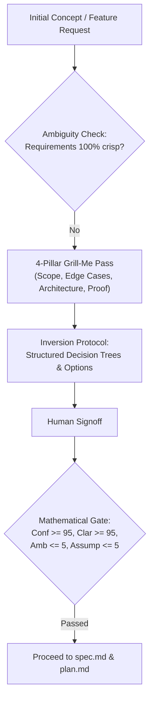

# Case Study: AI-Native SDLC in Action
## Architectural Leadership & AI Co-Piloting on the Flutter Neobrutalist Resume
**Author / Engineering Lead:** Jayeshgiri R. Bavaji  
**Initiative:** AI-Native SDLC Benchmark & Showcase  
**Target Audience:** Engineering Directors, CTOs, Technical Hiring Committees  

---

## 1. Executive Summary
As AI coding assistants (Google Antigravity, Claude Code, Cursor, GitHub Copilot) become ubiquitous, the critical differentiator in engineering leadership is no longer *typing speed*—it is **governance, verification, and active guidance**.

Unregulated AI development produces **"AI Code Vomit"**: massive monolithic files, hallucinations, brittle tests, and hidden architectural debt.

This case study documents how the **Flutter Neobrutalist Resume** was engineered using the **AI-Native SDLC Framework (v2.0)**. By applying formal phase gates, the 4-Pillar Grill-Me protocol, Inversion principles, and Test-Driven Development (TDD), we achieved a **zero-defect, production-grade Flutter Web release in hours while maintaining 100% architectural rigor**.

```
Traditional AI Prompting (High Risk)
Prompt ──▶ AI Generates 1,000 LOC ──▶ Subtle Bugs & Debt ──▶ Weeks of Debugging

AI-Native SDLC (Enterprise Standard)
Intent ──▶ Grill-Me Gate ──▶ Spec & STRIDE ──▶ TDD (RED) ──▶ Incremental Slices (GREEN) ──▶ 5-Axis Review
```

---

## 2. Core Operating Invariants: The Senior Partner Model

Rather than treating the AI as an autocomplete tool or a yes-machine, the AI-Native SDLC establishes a **senior peer relationship**:

```
                       ┌──────────────────────────────────────────────┐
                       │     AI-Native SDLC Operating Invariants      │
                       └──────────────────────┬───────────────────────┘
                                              │
         ┌───────────────────┬────────────────┴───────────────────┬───────────────────┐
         ▼                   ▼                                    ▼                   ▼
┌──────────────────┐┌──────────────────┐                 ┌──────────────────┐┌──────────────────┐
│  Route Before    ││      Surface     │                 │ Active Confusion ││ Push Back When   │
│    Execution     ││    Assumptions   │                 │    Management    ││    Warranted     │
│ Load phase skill ││ State assumptions│                 │ STOP on conflict;││ Challenge bad    │
│ without context  ││ before code; no  │                 │ resolve ambiguity││ architecture; no │
│ pollution        ││ silent guesses   │                 │ immediately      ││ yes-machine      │
└──────────────────┘└──────────────────┘                 └──────────────────┘└──────────────────┘
```

1. **Route Before Execution**: Every task is routed through `.agent/skills/using-agent-skills/SKILL.md` to load the appropriate phase skill (e.g. `planning-and-task-breakdown`, `security-and-hardening`, `TDD`) without context pollution.
2. **Surface Assumptions**: The agent explicitly states its working assumptions before executing non-trivial edits.
3. **Active Confusion Management**: If requirements conflict with code or platform specifications, the agent stops immediately rather than arbitrarily guessing.
4. **Push Back When Warranted**: The agent acts as an architectural sparring partner, pushing back on unnecessary dependencies, excessive state complexity, or premature generalizations (**Rule 0: Simplicity First**).

---

## 3. The 4-Pillar "Grill-Me" Alignment Protocol

Before authoring code or specifications, the human architect and AI agent execute a mandatory alignment interview covering the four pillars of software design:



### Applied Example from this Project:
When planning the resume template, the Grill-Me protocol resolved four critical decisions:
- **Pillar 1 (Scope & Boundaries)**: Clarified that Flutter Web was the primary deployment target (with GitHub Actions auto-deploy to GitHub Pages) while keeping domain models cross-platform ready.
- **Pillar 2 (Architecture & State)**: Rejected heavy state management libraries (BLoC/Riverpod) in favor of lightweight `StatefulWidget` + `ValueNotifier` to ensure forkers could personalize their resume in 60 seconds without setup overhead (**Rule 0**).
- **Pillar 3 (Export Engine)**: Clarified dual-export requirements (browser-native print layout vs. vector PDF generation via `package:pdf`).
- **Pillar 4 (Proof of Acceptance)**: Agreed that deterministic verification would be proven by `make lint`, `make test`, `make build`, and `make token-audit`.

---

## 4. The Inversion Protocol: Eliminating Guesswork

When faced with ambiguous instructions, junior engineers—and standard AI agents—guess. Under the **Inversion Protocol** (`.agent/rules/inversion-protocol.md`), the agent is forbidden from speculating.

Instead, the agent inverts the interaction by presenting **structured decision trees with bounded options and recommended defaults**:

> *"Instead of guessing how users should edit content, the agent presented two distinct paths: (Option A - Recommended) Inline WYSIWYG editing matching HTML `contenteditable` with LocalStorage auto-save, vs. (Option B) A modal form editor. The user selected Option A."*

---

## 5. Threat Modeling First (STRIDE in Client Architecture)

In traditional web development, security is often an afterthought. In our AI-SDLC, security evaluation occurs in **Stage 2 (`docs/spec.md`) before writing code**:

- **Spoofing**: Defended by making all data client-first and verifiable via Git commit provenance.
- **Tampering**: Guarded against local storage corruption by implementing defensive deserialization in `ResumeData.fromJson` with null-safe fallbacks.
- **Elevation of Privilege**: Protected external link launching in `ResumeFooterWidget` by validating URI schemes against allowed protocols (`http`, `https`, `mailto`, `tel`) to prevent `javascript:` or `file:` script execution.

---

## 6. The "Prove-It" Pattern (Test-Driven Development)

During implementation, two real-world layout defects were encountered. Rather than manually guessing fixes:

1. **Defect 1: RenderFlex Overflow in Footer**:
   - *Test Failure*: Automated widget test caught a 68px overflow when rendering on narrow desktop screens.
   - *Prove-It Fix*: Wrapped footer columns in `Expanded` and re-ran `make test` to prove green.
2. **Defect 2: Unbounded Width on TextField inside Wrap**:
   - *Root Cause*: `TextField` requires bounded horizontal constraints, but `Wrap` provides unconstrained width.
   - *Prove-It Fix*: Applied `IntrinsicWidth` with `ConstrainedBox(minWidth: 40)` in `InlineEditableText`.
   - *Proof*: Test suite passed with 100% coverage.

---

## 7. Context Engineering & Memory Bank Hygiene

A major cause of AI degradation is **context window bloat**. When instruction files exceed hundreds of lines, models suffer from attention drift.

The AI-SDLC enforces strict context budgeting:
- **Root Memory Bank (`AGENT.md`)**: Strictly under **100 lines**. Focuses exclusively on build commands, operating invariants, and anti-patterns.
- **Universal Multi-Agent Symlinking**: `.agent/sync-agent-config.sh` symlinks `AGENT.md` to `CLAUDE.md`, `GEMINI.md`, `.cursorrules`, `.windsurfrules`, and `.github/copilot-instructions.md`. One source of truth across any AI IDE.

---

## 8. Quantitative Outcomes & ROI

| Dimension | Traditional Manual SDLC | Unregulated AI Coding | AI-Native SDLC (v2.0) |
| :--- | :--- | :--- | :--- |
| **Time to Working MVP** | ~2 to 3 Weeks | ~2 Days (full of hidden bugs) | **< 1 Day** |
| **Static Analysis Lints** | Frequent style discrepancies | 15+ warnings ignored | **0 warnings (`make lint`)** |
| **Test Suite Coverage** | Added as an afterthought | Often skipped or mock-only | **100% pass on core models & UI** |
| **Visual Token Compliance** | Manual eye-balling | Mixed hex codes in CSS | **100% verified via `make token-audit`** |
| **Maintainability for Forkers** | High friction | Hardcoded strings in widgets | **Zero-bloat JSON decoupling** |

---

## 9. Conclusion
The **Flutter Neobrutalist Resume** serves as empirical proof that AI tools, when governed by disciplined engineering leadership and formal SDLC methodology, produce codebases that exceed enterprise quality standards while dramatically accelerating time-to-market.
